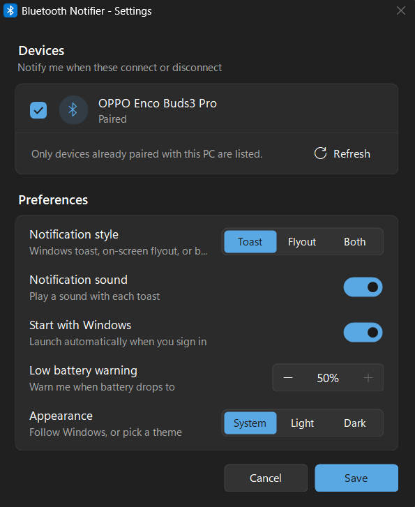
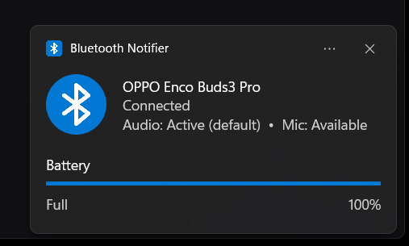

# Bluetooth Notifier

A lightweight Bluetooth device monitor for **Windows 11**. It runs in the system tray and notifies you when selected Bluetooth headphones, earbuds, mice, keyboards, or other supported devices connect or disconnect.

The app can also show the device battery level, audio output status, and microphone availability. It is designed to stay small and unobtrusive while running in the background.

## Features

- Monitor multiple paired Bluetooth devices by their Bluetooth address.
- Support classic Bluetooth and Bluetooth Low Energy devices.
- Show Windows toast notifications, an on-screen flyout, or both.
- Display battery percentage and warn when the battery reaches a configurable level.
- Show audio output and microphone status for connected devices.
- Play a notification sound for toast notifications.
- Start automatically with Windows.
- Follow the Windows theme or use a light/dark appearance in Settings.
- Keep the tray process lightweight by running settings and diagnostics separately.

## Screenshots

### Settings



### Connected device notification



## Compatibility

- **Operating system:** Windows 11
- **Architecture:** 64-bit Windows (`win-x64`)
- **Runtime:** The published application is self-contained and does not require .NET to be installed on the target PC.

The device must already be paired in Windows Bluetooth settings. Notifications depend on the information Windows makes available for each device.

## For users

1. Run **BtNotifier-Setup.exe**. The installer asks **where to install** (default: your user programs folder, no admin rights needed).
2. On first launch the settings window opens. Tick your device(s), choose sound / low-battery level / appearance, click **Save**.
3. It starts with Windows automatically and lives in the system tray.

Tips:
- On Windows 11 the tray icon may be hidden under the **^** arrow. Drag it onto the taskbar to keep it visible.
- Double-click the tray icon (or right-click > **Settings...**) to change anything later.
- The device must already be paired in Windows. Classic Bluetooth and Bluetooth Low Energy devices are supported.
- Devices are remembered by Bluetooth address, so similar names never get mixed up.
- Uninstall from Settings > Apps.

**Notification style** (Settings): choose **Toast** (normal Windows notification), **Flyout** (a small on-screen indicator near the taskbar, like the Windows 11 Num Lock / volume popup) or **Both**. Choosing Flyout turns the toast off. Use **Test notification** in the tray menu to preview.

About the flyout:
- Shown for connect, disconnect and low battery, for 3 seconds (`FlyoutSeconds` in the config); click it to dismiss.
- It never takes focus, and it is skipped while a full-screen game/video or a presentation is running.
- It is drawn by the app itself, so it ignores Do Not Disturb and is not announced by screen readers. Keep **Toast** or **Both** if you rely on those.
- The notification sound only applies to toasts.

Tray menu: **Settings...**, **Test notification**, **Diagnostics...** (also shows current memory use), **Open log**, **Exit**.

## Building

```
winget install Microsoft.DotNet.SDK.8
winget install JRSoftware.InnoSetup
.\build.ps1
```

This produces `publish\BtNotifier.exe` (self-contained, no .NET needed on the target PC) and `dist\BtNotifier-Setup.exe`.
For development: `dotnet run -c Release` (the project has no NuGet packages).

## Files

| File | Purpose |
|---|---|
| `Program.cs` | Entry point; picks tray mode or UI mode from the command line |
| `TrayApp.cs`, `Native.cs` | Lightweight Win32 tray host, native menu, timers, power and reload messages |
| `Bluetooth.cs` | Discovery (classic + LE), connection tracking, battery, audio probe, per-device logic |
| `Toast.cs` | Raw toast XML through WinRT |
| `Flyout.cs` | On-screen flyout, drawn with plain GDI inside the tray process |
| `Notifier.cs` | Decides toast / flyout / both from the settings |
| `Config.cs` | Paths, config (source-generated JSON), log, autostart |
| `UiHost.cs` | Runs the WinForms windows in their own process |
| `SettingsForm.cs`, `Theme.cs`, `Controls.cs` | Settings window, Diagnostics dialog, light/dark theme and custom controls |
| `installer.iss`, `build.ps1` | Installer and one-step build |

## Config and logs

`%LocalAppData%\BtNotifier\` holds `config.json` and `bt-notifier.log`. The settings window edits the config. Keys: `ShowToast`, `ShowFlyout`, `Appearance` (`System`, `Light`, `Dark`). Advanced: `FlyoutSeconds`, `BatteryPollMinutes`, `SettleSeconds`, `LogoPath`.

## Troubleshooting

- **No toast:** check Windows Settings > System > Notifications (the app appears as "Bluetooth Notifier"), and that Do Not Disturb is off.
- **Toast header shows a generic name/icon:** run the app once through the installer shortcut; the shortcut carries the app identity.
- **Battery "not reported":** open Diagnostics and look at the devnode list; if none shows a value, Windows is not getting battery from the device.
- **Device missing from the list:** pair it in Windows Settings, then click **Refresh**.
- **Autostart after moving the install folder:** the app rewrites its startup entry to its current location every launch.
